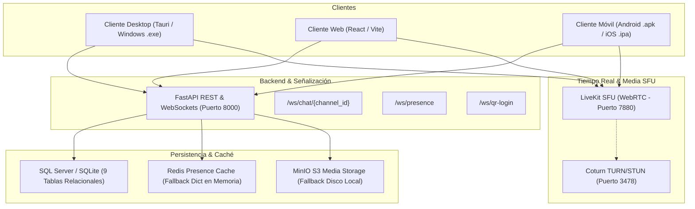
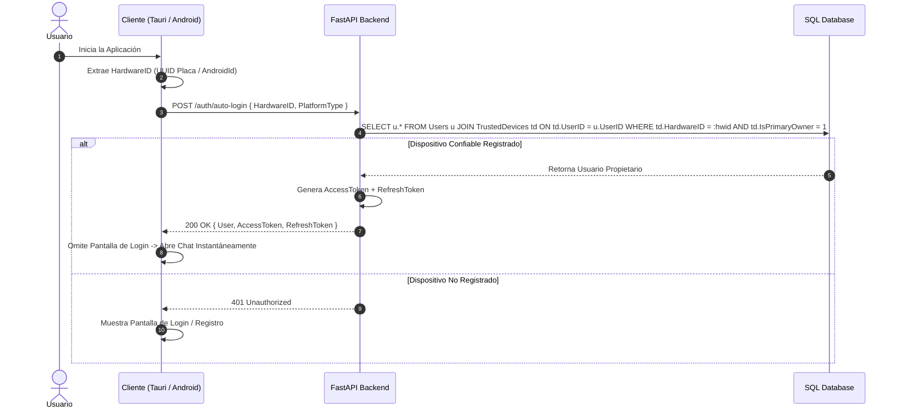
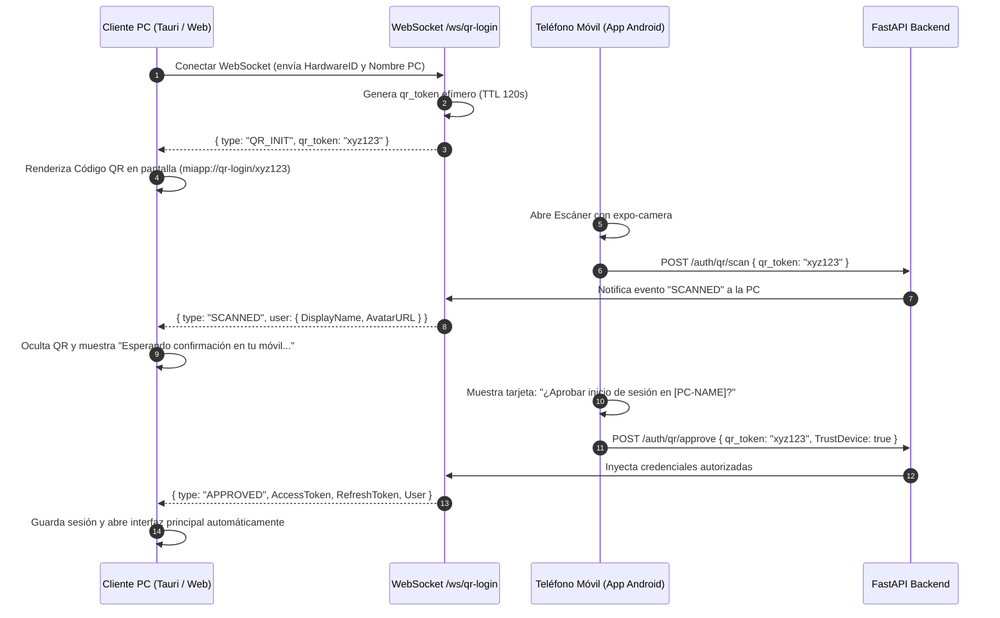

# Arquitectura Técnica del Sistema — Echo

Documento maestro de especificación y arquitectura técnica de **Echo**, una plataforma privada de comunicación en tiempo real estilo Discord con capacidades de chat, voz, video en alta definición (LiveKit WebRTC), notas de voz Opus con forma de onda interactiva, sistema de autenticación por Hardware ID y QR, permisos bitwise y estudio de animación frame-by-frame acelerado por GPU.

---

## 1. Diagrama de Arquitectura Global



---

## 2. Sistema de Identidad Dual y Reconocimiento de Dispositivo (Zero-Click Auto-Login)

### 2.1. Identidad Dual (`Username` vs `DisplayName`)
* **`Username`:** Identificador único global e inmutable sensible a minúsculas (`UNIQUE NONCLUSTERED INDEX` en SQL). Utilizado exclusivamente para iniciar sesión, búsquedas exactas del sistema y menciones `@usuario`.
* **`DisplayName`:** Nombre visible de libre configuración por el usuario. Admite caracteres UTF-8, espacios, tildes y emojis. Se muestra prominentemente en la lista de miembros, mensajes de chat y tarjetas de participante en salas de voz y video.

### 2.2. Flujo de Auto-Login por Hardware ID (Zero-Click)



---

## 3. Protocolo de Inicio de Sesión QR (Estilo Discord)

Permite a un usuario con sesión activa en su teléfono iniciar sesión en una PC de escritorio o navegador web sin escribir credenciales:



---

## 4. Matriz de Permisos Bitwise (64-bit Integer)

Para garantizar un rendimiento de validación de permisos en microsegundos, Echo utiliza una máscara de bits almacenada en una columna `BIGINT` (`Permissions`):

| Bit Flag | Valor Decimal | Nombre del Permiso | Descripción |
| :--- | :--- | :--- | :--- |
| `1 << 0` | `1` | `ADMINISTRATOR` | Bypass total de todas las restricciones del servidor |
| `1 << 1` | `2` | `MANAGE_SERVER` | Modificar ajustes del servidor e invitaciones |
| `1 << 2` | `4` | `MANAGE_CHANNELS` | Crear, editar y eliminar canales |
| `1 << 3` | `8` | `MANAGE_ROLES` | Asignar y modificar roles de miembros |
| `1 << 4` | `16` | `KICK_MEMBERS` | Expulsar usuarios del servidor |
| `1 << 5` | `32` | `BAN_MEMBERS` | Banear permanentemente a usuarios |
| `1 << 6` | `64` | `SEND_MESSAGES` | Enviar mensajes y stickers en canales de texto |
| `1 << 7` | `128` | `CONNECT_VOICE` | Conectarse a salas de voz y escuchar |
| `1 << 8` | `256` | `SPEAK_VOICE` | Transmitir audio por micrófono |
| `1 << 9` | `512` | `STREAM_VIDEO` | Transmitir cámara web y compartir pantalla a 60 FPS |

### Operaciones a Nivel de Bits:
```python
# Conceder permiso
user_permissions |= PermissionFlags.STREAM_VIDEO

# Revocar permiso
user_permissions &= ~PermissionFlags.SPEAK_VOICE

# Comprobar permiso
def has_permission(user_perms: int, required_perm: int) -> bool:
    if user_perms & PermissionFlags.ADMINISTRATOR:
        return True
    return bool(user_perms & required_perm)
```

---

## 5. Arquitectura de Voz, Video y Compartir Pantalla (LiveKit SFU)

A diferencia de las arquitecturas Mesh (P2P completo) que saturan el ancho de banda del cliente a partir de 3 participantes, Echo utiliza **LiveKit SFU (Selective Forwarding Unit)**:

* **Topología:** Cada cliente envía un único stream de subida (audio Opus y video simulcast VP8/H.264).
* **Distribución:** El SFU reenvía selectivamente los paquetes RTP a cada suscriptor según su ancho de banda disponible y tamaño de ventana de video.
* **TURN/STUN (Coturn):** Supera cortafuegos empresariales y configuraciones de NAT simétrico mediante relaying UDP/TCP en el puerto 3478/5349.
* **Generación de Tokens JWT:** El backend de FastAPI emite tokens criptográficos firmados con `LIVEKIT_API_KEY` y `LIVEKIT_API_SECRET` conteniendo los permisos del canal (`canPublish`, `canSubscribe`).

---

## 6. Procesamiento de Notas de Voz Opus y Forma de Onda Interactiva

1. **Captura:** El cliente graba el audio en formato Opus encapsulado en Ogg/WebM a 48 kHz.
2. **Procesamiento de Onda (FFmpeg / Backend):** Al recibir el audio, se normaliza y se calculan **40 picos de amplitud matemática** distribuidos uniformemente entre 0.05 y 1.0.
3. **Persistencia:** El array JSON de 40 muestras se almacena en la columna `WaveformSamples` de la tabla `Messages`.
4. **Reproducción Interactiva:** El componente `<VoiceNoteRecorder />` renderiza 40 barras interactivas:
   - Permite arrastrar el cursor o hacer clic sobre cualquier barra para saltar (*seek*) a ese segundo exacto de la nota de audio.
   - Cuenta con selector de velocidad de reproducción (1.0x, 1.5x, 2.0x).

---

## 7. Motor de Animación GPU Frame-by-Frame (Skia)

Diseñado tanto para la versión web/desktop (Canvas 2D / WebGL) como para el cliente nativo móvil (`@shopify/react-native-skia`):
- **Sensibilidad a Presión y Dirección:** Curvas Bezier dinámicas calculadas mediante `perfect-freehand`.
- **Cebolla (Onion Skinning):** Superposición semitransparente (30% de opacidad) del fotograma anterior (en rojo) y posterior (en verde).
- **Interpolación de Posición:** Interpolación matemática lineal (LERP) entre fotogramas clave (*keyframes*).
- **Borde Blanco Troquelado (Sticker Die-Cut):** Dilatación morfológica por máscara de píxeles (`Skia Paint` con filtro `ImageFilter.makeBlur` o dilatación de canvas) que genera un contorno blanco nítido estilo sticker de mensajería.
- **Exportación:** Generación directa de WebP animado y paquetes de stickers JSON.
